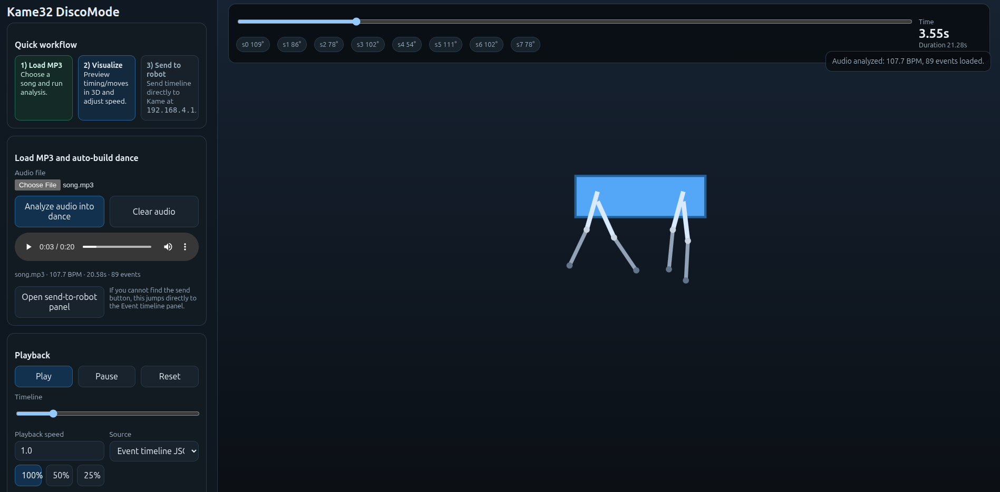

# Kame32 DanceMode & TeachMoves

A Flask web app for building and previewing Kame32 dance timelines, then optionally streaming them to a robot over the stock Wi-Fi HTTP API.



## What this app does

- 3D (or fallback 2D) movement preview in the browser (local static Three.js preferred; CDN fallback)
- Multiple preview modes:
  - live joystick gait
  - button routine approximations
  - manual 8-servo pose
  - event timeline JSON
  - keyframe JSON
- Audio upload (`.mp3`, `.wav`, `.ogg`, `.m4a`, `.flac`) and automatic dance-event generation using `librosa`
- Browser audio synchronization so motion follows the media clock
- Playback speed controls (`100%`, `50%`, `25%`, plus numeric custom speed)
- Send timeline directly to robot via:
  - `GET /joystick?x=...&y=...`
  - `GET /button?label=...`
- Dry-run send validation and send-speed throttling (`0.25` to `1.0`)

## Quick start

```bash
python -m venv .venv
source .venv/bin/activate
pip install -r requirements.txt
python app.py
```

Open: <http://127.0.0.1:5000>

### Log verbosity

Use `KAME32_LOG_LEVEL` to control Flask app logging without code changes:

```bash
KAME32_LOG_LEVEL=DEBUG python app.py
```

Accepted values include standard logging names (`DEBUG`, `INFO`, `WARNING`, etc.) or numeric levels.

## Pages

- **DanceMode** (`/`): analyze music, preview timelines, and send supported events to the robot.
- **TeachMoves** (`/teach-moves`): use the Source selector for joystick gait, button routines, or manual servo poses. Choose Move1–Move6, click Record, adjust controls, then Stop recording. Recordings capture the preview as servo keyframes for up to 60 seconds.

Saved moves are shared with MCP clients and persisted on the app server. Select a populated slot and Play move to preview it, Re-record to replace it, or Delete move to clear it. Use in DanceMode transfers its keyframes to the main page. Existing browser-local slots import once into empty shared slots. Stop recording before leaving to save; status messages report storage failures.

TeachMoves recording and preview remain local. Its explicit **Send move to robot** action uses Auto, Stock compatibility, or Exact pose playback. Stock mode replays a saved joystick/button track; exact servo poses require upgraded pose/watchdog firmware. Pose-only recordings are refused on stock firmware. See [FIRMWARE.md](FIRMWARE.md) for the patch, builds, flashing, and hardware acceptance checks.

## Primary workflow

1. **Load MP3/audio** in the left panel.
2. Click **Analyze audio into dance**.
3. Inspect/edit generated **Event timeline JSON**.
4. Preview with **Play** and optional slower playback.
5. Optionally send to hardware with **Send timeline to robot**.

## API summary

### `POST /api/analyze-audio`

`multipart/form-data` with field name `audio`.

Success response includes:

- `filename`
- `tempo`
- `duration`
- `events`
- `event_count`

Common error codes:

- `missing_audio`
- `missing_filename`
- `unsupported_audio_format`
- `audio_analysis_failed`
- `upload_too_large`

### `POST /api/send-to-robot`

Example request:

```json
{
  "base_url": "http://192.168.4.1",
  "events": [
    {"t": 0.0, "kind": "button", "payload": "Start"},
    {"t": 0.2, "kind": "joystick", "payload": [0, 70]},
    {"t": 1.2, "kind": "joystick", "payload": [0, 0]},
    {"t": 1.3, "kind": "button", "payload": "Stop"}
  ],
  "send_speed": 0.5,
  "dry_run": false
}
```

Validation/limits:

- events required, non-empty, and sorted by ascending `t`
- max events: `5000`
- max timeline timestamp: `600s`
- supported kinds: `button`, `joystick`, and `pose` (upgraded firmware required)
- allowed button labels: `A B C X Y Z Start Stop`
- `send_speed` range: `0.25..1.0`

Behavior:

- Joystick/button timelines enforce initial Start/neutral and terminal neutral/Stop. Pose timelines use Start/Stop without inserting gait-home movements; inserted events count toward the 5,000-event limit.
- `dry_run=true` validates and returns metadata without network dispatch.
- Live dispatch allows one active request per process; another receives `409 robot_busy`. The deadline is the normalized timeline duration divided by speed, plus 15 seconds.
- Timeout requests cooperative cancellation. On failure or cancellation, the worker attempts neutral and Stop independently; delivery cannot be guaranteed after network loss.


## 3D without browser setting changes (install locally)

The app now tries **local static Three.js modules first**, then CDNs (`jsDelivr`, `unpkg`) as fallback.

If your environment blocks CDNs, vendor modules locally once:

```bash
./scripts/install_three_local.sh
```

This script installs `three@0.164.1` via npm in a temp directory and copies only:
- `three.module.js`
- `OrbitControls.js`

During install, it also rewrites `OrbitControls.js` to import the local `three.module.js` path (instead of bare specifier `three`), so browser import-map settings are not required.

into:
- `static/vendor/three/build/three.module.js`
- `static/vendor/three/examples/jsm/controls/OrbitControls.js`

Then restart Flask and reload the page.

If local files are missing and CDNs are blocked, the app degrades to 2D preview mode.

If you still see `3D module failed to load (local/CDN unavailable)` after vendoring, hard-refresh once to clear any cached failed module imports.

## Tests

```bash
python -m unittest discover -s tests -v
```

## Notes

- This project is a practical preview/scripting tool, not an exact physical digital twin.
- Button routine animations are approximations of style/timing.
- Audio analysis generates event timelines (buttons + joystick moves), not IK-optimized choreography.

## Development and deployment notes

Python 3.12 was validated with the declared dependencies. There is no dependency lockfile, so unpinned transitive versions may change between installs. The local Three.js modules are already included; the vendoring script is only needed to refresh them.

For the managed cloud environment, the Python environment is `/workspace/.venvs/kame32-discomode`. Use a dedicated Numba compilation cache for both app and tests:

```bash
export NUMBA_CACHE_DIR=/workspace/.cache/kame32-numba
/workspace/.venvs/kame32-discomode/bin/python app.py
# In another terminal, from the repository root:
/workspace/.venvs/kame32-discomode/bin/python -m unittest discover -s tests -v
```

The default package-local compiled cache caused a native crash during onboarding. A dedicated cache passed the 19-test suite on initial compilation and reuse. This is a validated environment workaround; the underlying compiler/cache cause has not been established.

The default server binds to loopback. Keep this experimental app limited to trusted users: robot dispatch has no authentication. Joystick coordinates must be integers in `[-100, 100]`; `dry_run` must be a JSON boolean. Use `dry_run: true` for checks without hardware. Live robot connectivity was not validated in cloud setup.

Live sends default to the configured origin `http://192.168.4.1`. To use another robot, set a comma-separated list of exact HTTP(S) origins before starting Flask:

```bash
KAME32_ROBOT_ORIGINS=http://192.168.4.1,http://robot.local python app.py
```

Origins cannot contain credentials, paths, queries, or fragments. Redirects are rejected. Dry runs validate the URL syntax without requiring it in the live-send allowlist. The one-send limit is process-local; run one app process for robot control. The upgraded firmware includes an independent robot-side watchdog and controller leases; install and physically validate it as described in FIRMWARE.md.

Current findings and validation limits are in [AUDIT.md](AUDIT.md); implementation contracts are in [SPEC.md](SPEC.md).

## MCP for AI clients

Install `requirements-mcp.txt`, run Flask, then configure your MCP client to launch `python mcp_server.py` over stdio. Streamable HTTP is also supported on loopback. The integration provides audio analysis, shared moves, browser preview/recording controls, resources, prompts, and a separate explicit live robot-dispatch tool. See [MCP.md](MCP.md) for client configuration, tool schemas, and command acknowledgment behavior.

## Stock firmware compatibility

TeachMoves records a stock joystick/button command track alongside its pose preview when you use only joystick/button controls, default gait settings, and 100% preview speed. Choose **Compatibility: stock firmware** to replay those commands without a firmware update, or **Auto** to prefer exact poses on updated firmware and fall back to the recorded commands on stock firmware. Manual servo poses and older pose-only recordings cannot be converted accurately; re-record them using stock controls or install the update. Stock firmware has no disconnect watchdog and its blocking routines can delay timing/cancellation.

## Docker

Run `docker compose up --build -d` for the app and MCP server with persistent recordings, pinned Python dependencies, and non-root processes. See [DOCKER.md](DOCKER.md) for ports, audio, managed-proxy builds, and validation.

## Audio analysis budgets

Uploads run in a disposable Linux worker process, separate from robot dispatch. One analysis is admitted per app process; concurrent requests receive `429 audio_analysis_busy`. The worker has a 120-second CPU budget, 4 GiB address-space ceiling, 180-second wall-clock deadline, and a 599-second decoded-duration limit. Decoding reads at most 600 seconds before checking duration. Timeout kills the worker process group, including decoder children, and returns `504 audio_analysis_timeout`. Native failures/resource exhaustion return the existing structured analysis failure. These limits contain analysis work; they do not provide hard real-time robot guarantees. Keep the single-worker deployment described in DOCKER.md.

## Validation and remaining work

The current Docker build passed all 55 tests. Real MP3 analysis, concurrent-upload rejection, robot-status responsiveness during analysis, browser recording/stock compatibility, MCP connectivity, and recording persistence across container recreation were verified. Both companion ESP32 firmware targets compile; no physical robot was flashed or tested.

Remaining priorities are physical calibration/watchdog acceptance, authentication and TLS before remote exposure, and move export/import plus scheduled backups. Named Docker volumes retain data across container recreation but are not independent backups. See [AUDIT.md](AUDIT.md) for current findings, [DOCKER.md](DOCKER.md) for deployment, [MCP.md](MCP.md) for AI clients, and [FIRMWARE.md](FIRMWARE.md) for the optional update.
