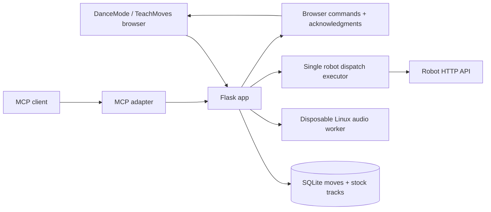

# Architecture

The app separates browser preview, server dispatch, and resource-limited audio processing. Flask is the authoritative application backend; MCP calls that same instance rather than creating another robot executor.

## Modules

| File | Responsibility |
| --- | --- |
| [app.py](../app.py) | Routes, analysis algorithm, event validation/bookends, capabilities, dispatch and cancellation |
| [control_api.py](../control_api.py) | Shared move CRUD, browser registration, bounded command delivery/acknowledgment |
| [audio_process.py](../audio_process.py) | One-job admission, subprocess lifecycle, wall timeout and cleanup |
| [audio_worker.py](../audio_worker.py) | Apply CPU/address-space budgets before scientific imports; emit analysis JSON |
| [mcp_server.py](../mcp_server.py) | SDK tools, resources, teaching prompt, stdio/Streamable HTTP |
| [static/app.js](../static/app.js) | Shared renderer, transport, preview sources, API client and preview command interface |
| [static/teach.js](../static/teach.js) | Slot recording, shared storage, stock-track capture and explicit move send |
| [static/mcp-bridge.js](../static/mcp-bridge.js) | Heartbeat, browser command polling and execution acknowledgment |

## Preview and recording

Preview sources are joystick gait, button routine approximations, manual eight-servo pose, event timeline, and interpolated keyframes. Local Three.js/OrbitControls load first; CDN and 2D fallbacks are documented in [development](development.md#3d-preview). Audio synchronization uses the browser media clock; otherwise the transport advances its own clock.

TeachMoves samples pose frames and supported native source commands every 50 ms for up to 60 seconds. Unsupported/custom/paused/speed-adjusted controls suppress the entire stock track. SQLite saves frames and optional native commands transactionally. Browser-local legacy slots import once into empty server slots. Move transfer to DanceMode uses session storage and starts paused.

## Audio pipeline

Uploads are analyzed in a separate process, with [explicit budgets](api.md#audio-analysis-budgets). The algorithm loads mono audio at 22,050 Hz, separates harmonic/percussive components, measures onset/beat/energy/centroid/bass features, infers bar accents/sections, and emits button/joystick patterns. Sparse beats use a fallback grid. Generated timelines receive terminal neutral/Stop and near-duplicate joystick compaction. The heuristic is not an inverse-kinematics optimizer or a calibrated digital twin.

## Dispatch and firmware

Validation precedes dispatch admission. The app normalizes required control boundaries, checks the live origin allowlist, probes capabilities, and schedules commands against a monotonic clock. Auto can choose an existing stock track; it never derives one from servo angles. Pose streaming requires advertised pose/watchdog/lease-token features, carries one controller token, and maintains heartbeats during gaps.

Cancellation signals the worker and retains the dispatch slot until cleanup completes. Device state is not inferred from a successful app cancellation response. The companion [firmware patch](firmware.md) adds an independent FreeRTOS watchdog and a cancellable routine worker. Physical behavior remains unverified.

## State and deployment boundaries

SQLite persists six slots and optional native command tracks. In-memory dispatch admission/cancellation, browser registrations, and command history belong to one app process. Keep one app worker/container until shared coordination exists. Audio admission is also process-local.

Docker uses separate app/MCP containers on normal Compose networking. The adapter explicitly trusts the private app hostname; outside Docker its default is loopback. See [Docker](docker.md) for paths, volumes, health checks, and ports. Persistence is not an independent backup.

## Validation and follow-up

The latest recorded deployment passed 55 tests, browser/HTTP smoke checks, and restart/recreation persistence checks. Both ESP32 targets compiled and native watchdog lease tests passed. Full frontend coverage, physical acceptance, remote authentication/TLS, and scheduled backups/export-import remain outstanding. See [audit](audit.md).
